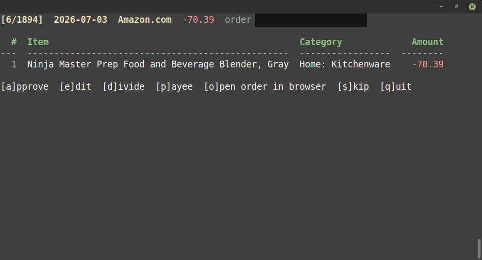
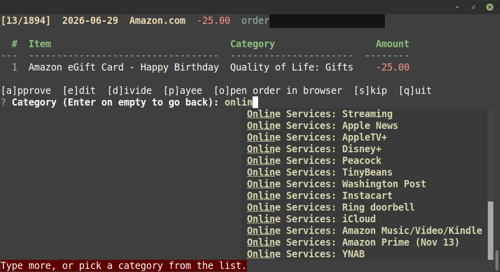

# YNABuddy

Console app that matches vendor order data (i.e. Amazon, Costco) to
[YNAB](https://www.ynab.com) transactions, splits each transaction by the items bought, helps you categorize the lines, and writes the approved splits back to YNAB.

What it does today (v1.0.0):

- **Amazon data**: scrapes your Amazon order history and card charges with
  [amazon-orders](https://github.com/alexdlaird/amazon-orders) 
- **Matching**: each YNAB transaction is matched to an Amazon charge or
  order by exact amount and date.
- **Splitting**: the charged amount is split across the items; shipping,
  discounts and rounding are spread over the items (sales tax on its own
  line is an option, off by default).
- **Review screen**, one key per action:
  `[a]pprove  [e]dit  [d]ivide  [p]ayee  [o]pen order in browser  [s]kip  [q]uit`
  -- edit categories and payees with autocomplete; a per-plugin item -> category
  table remembers your choices.
- **AI suggestions (optional)**: Claude, OpenAI or Gemini suggest categories
  for new items in the background; you approve every one.
- **Push**: approved splits are written to the budget selected in Settings,
  after a y/n prompt and a check that nothing changed in YNAB meanwhile.

Docs: code diagrams
`DIAGRAM.md`.

## Running

Needs [uv](https://docs.astral.sh/uv/) (it installs the right Python and the
dependencies), a YNAB personal access token, and an Amazon account.

```
uv sync
uv run playwright install chromium   # amazon-orders' browser login fallback
uv run python run.py
```

Run `run.py` from the project root -- don't run `core/main.py` directly;
its imports (`from core import ...`) only resolve with the project root on
`sys.path`.

The first run asks for the YNAB token and a budget, then each plugin's
required settings (for Amazon: which YNAB account(s) hold Amazon
transactions, and the Amazon login). Changing the budget later clears the
plugin accounts and asks for the new budget's.

## Screenshots

The review screen: one transaction, its split lines and the keys.



Editing a category: autocomplete over the budget's categories.



## Tests

```
uv run pytest -q
```

Offline: a guard in `tests/conftest.py` makes any real YNAB, Amazon or AI
request -- or browser launch -- fail the test.

## Where things are stored

All per-install and gitignored:

- Secrets: `core/.env` (YNAB token, AI keys), `plugins/<plugin>/.env` (vendor
  login), the Amazon session cookies -- readable by your user only.
- Settings: `core/user_prefs.json`, `plugins/<plugin>/<plugin>_user_prefs.json`.
- Data: `core/ynab_categories.json` (the budget's categories),
  `plugins/amazon.com/amazon.com_order_data.json` (scraped orders and
  charges), `plugins/<plugin>/<plugin>_ynab_matched.json` (latest match
  results and review progress), `plugins/<plugin>/<plugin>_ynab_approved.json`
  (approved, waiting to be pushed), `plugins/<plugin>/<plugin>_categories.json`
  (item -> category table).
- Status log: `ynabuddy.log`; Amazon debug snapshots (off by default): `output/`.
